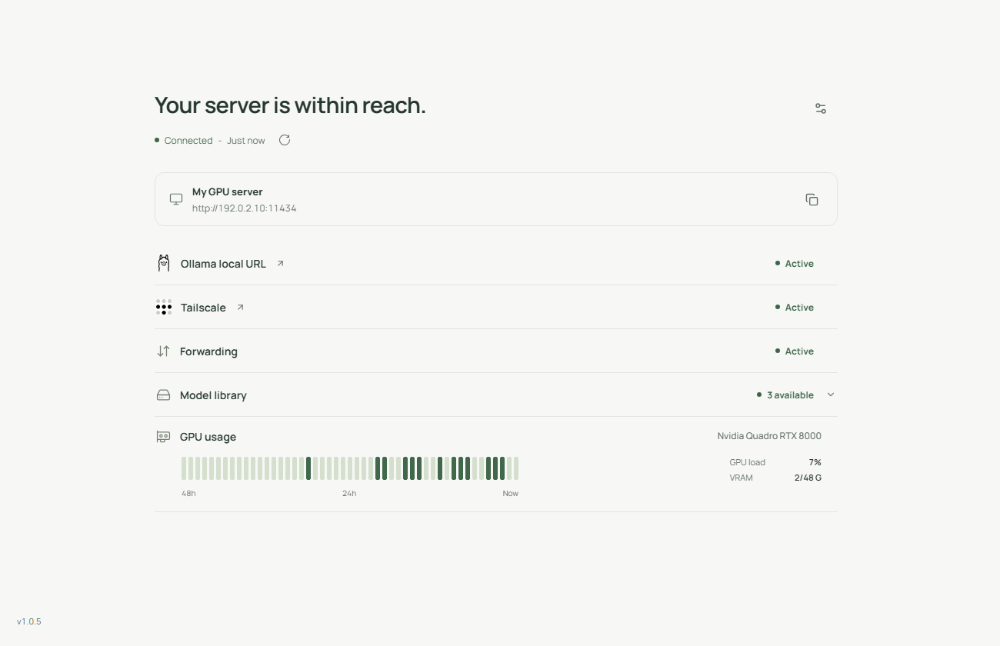

# Shambu

Your GPU is at home. You are somewhere else. Shambu checks that the two of you are still on speaking terms.

One small window shows whether Ollama, Tailscale, and the private connection are working, which models are available, and how the GPU is doing: live load, memory usage, and 48 hours of activity.

## Get the app

| Your device | Download |
| --- | --- |
| Mac with Apple Silicon | [Mac app](https://github.com/desigrit/shambu/releases/latest/download/Shambu-Mac-Apple-Silicon.dmg) |
| Windows with Intel or AMD | [Windows x64](https://github.com/desigrit/shambu/releases/latest/download/Shambu-Windows-x64-Setup.exe) |
| Windows with Snapdragon or another ARM processor | [Windows ARM64](https://github.com/desigrit/shambu/releases/latest/download/Shambu-Windows-ARM64-Setup.exe) |
| Android phone | [Android APK](https://github.com/desigrit/shambu/releases/latest/download/Shambu-Android-arm64.apk) |

[Installation help](docs/install.md)

## Bring your GPU along, figuratively

1. **On the GPU PC:** install Ollama and Tailscale, then follow the [one-time server setup](docs/server-setup.md). Add the [Shambu host companion](docs/host-agent.md) for GPU readings and the PC’s connection checks.
2. **On your other device:** install Tailscale, sign in with the same account, and open Shambu.
3. **In Settings:** choose **Remote server**, paste the GPU PC’s Tailscale Ollama URL, and enter the eight-character code shown in Shambu’s Settings on that PC. Save. Done.

## Why Shambu?

Named after Shikari Shambu, one of the comic-book characters I grew up with. This one also keeps an eye on things, preferably without leaving his chair.

There’s an easter egg. Try **Ctrl + Shift + K** on a PC or Mac.

[Releases](https://github.com/desigrit/shambu/releases) · [Troubleshooting](docs/operations.md) · [Build from source](app/README.md) · [Privacy](docs/privacy.md)

On Windows and Mac, future updates appear beside the version number in the app.
