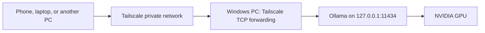

# Shambu

Shambu is a small app that keeps an eye on your private GPU server. One page shows Ollama, Tailscale, forwarding, installed models, and a rolling 24-hour strip of observed Ollama GPU activity on Windows, macOS, and Android.

This repository also includes the Windows setup guide and startup scripts for running Ollama on a GPU PC and reaching it privately through Tailscale. Use the same endpoint from a laptop at home, a phone on mobile data, or a computer while traveling.

The PC runs the model. Your other devices send requests and receive results. Applications need an Ollama or compatible API connection setting; this does not turn the PC into a directly attached graphics card for another device.

## Readiness app

A single-screen app for Windows, Mac, and Android checks Ollama, Tailscale, forwarding, GPU allocation, and installed models. Windows and the other native backends use Rust through Tauri. Checks never load a model.

See the [app guide](app/README.md) for setup and the [host companion guide](docs/host-agent.md) for pairing remote devices. Download platform packages from a successful [build workflow run](https://github.com/desigrit/shambu/actions/workflows/app.yml). The current packages are development builds.

Named after Shikari Shambu, with its R2-D2 icon artwork credited in the [branding notes](docs/branding.md).

## What is included

- Ollama and Tailscale setup for Windows.
- Client URLs for native Ollama and compatible applications.
- Optional background startup before Windows sign-in.
- CUDA detection checks and a recurring recovery trigger.
- GPU, network, and recovery checks.
- [Operations and troubleshooting](docs/operations.md).
- [Options for chat, images, and audio](docs/options.md).
- [Privacy and publishing notes](docs/privacy.md).

The networking setup mostly needs configuration. The PowerShell scripts cover Windows startup and recovery. They do not install a new model runtime, a chat interface, or an image/audio server.

## How it connects



Ollama stays on the PC's loopback interface. Tailscale forwards a private port to it. Devices need Tailscale access to the host. This guide does not require a router port forward or a public tunnel. [Tailscale Serve documentation](https://tailscale.com/docs/reference/tailscale-cli/serve).

## 1. Prepare the Windows PC

Install [Ollama](https://docs.ollama.com/windows), a compatible NVIDIA driver, and [Tailscale](https://tailscale.com/download/windows). The optional scripts in this repository target NVIDIA CUDA on Windows and Windows PowerShell 5.1.

With Ollama running, open PowerShell:

```powershell
nvidia-smi
ollama list
Invoke-RestMethod http://127.0.0.1:11434/api/version
```

Use an already downloaded model. If you need one for the examples, download it before switching to background startup:

```powershell
ollama pull qwen3:8b
```

Choose a model that fits the available GPU memory. Model weights, context, and concurrent requests all affect memory use.

Find the folder that actually contains your models. It should have a `manifests` directory and a `blobs` directory. A custom folder selected in the Ollama app may differ from the default used by a separate server process. Do not point the background server at an empty default folder. [Ollama model location settings](https://docs.ollama.com/windows#changing-model-location).

## 2. Connect Tailscale

Sign in to Tailscale on the GPU PC and each client device. For a personal setup, use the same account. In a shared tailnet, grant the intended devices access through its policy.

On the GPU PC, use an administrator PowerShell window:

```powershell
$tailscale = Join-Path $env:ProgramFiles 'Tailscale\tailscale.exe'
& $tailscale status
& $tailscale set --unattended=true
& $tailscale serve --bg --tcp=11434 tcp://127.0.0.1:11434
& $tailscale serve status
& $tailscale ip -4
```

If the CLI asks you to enable Serve, follow the account setup link it provides. Unattended mode keeps Tailscale available without an interactive Windows sign-in. Background Serve configuration persists across restarts. [Unattended mode](https://tailscale.com/docs/how-to/run-unattended), [Serve command reference](https://tailscale.com/docs/reference/tailscale-cli/serve).

Keep Ollama listening on `127.0.0.1:11434`. Broadening `OLLAMA_HOST` to every network interface is unnecessary for this forwarding setup.

## 3. Use the right URL on another device

Replace `<gpu-pc-tailscale-ip>` with the IPv4 address printed by `tailscale ip -4` on the GPU PC.

| Where you are connecting | URL |
| --- | --- |
| On the GPU PC itself | `http://127.0.0.1:11434` |
| Another device, at home or away | `http://<gpu-pc-tailscale-ip>:11434` |
| Version check from that device | `http://<gpu-pc-tailscale-ip>:11434/api/version` |
| An application using Ollama's OpenAI-compatible API | `http://<gpu-pc-tailscale-ip>:11434/v1` |

Do not enter `localhost` on the client device: that refers to the client itself.

For the native Ollama provider, enter the base URL without `/api/version`. For an OpenAI-compatible provider, use the `/v1` base URL and check which features the application needs. Ollama implements a subset of that API. Some clients require a non-secret placeholder in an API-key field; that field does not add authentication to the local server. [Compatibility reference](https://docs.ollama.com/api/openai-compatibility).

For [Zebby](https://github.com/desigrit/zebby-the-scout), choose the Ollama connection in its AI settings, use the GPU PC's Tailscale base URL, and select a model installed on that PC. The connection routes inference to the server; it does not synchronize the application's files or database.

The URL is an inference API. A browser opening its root does not provide a chat interface.

## 4. Verify access and GPU inference

First open the version URL from another device. Seeing a version confirms API reachability, not GPU use.

For a travel check, connect a phone to Tailscale, turn Wi-Fi off, and open the same version URL over mobile data.

When the GPU is free, run this from a Windows client or the host, replacing the placeholder:

```powershell
.\scripts\Test-Inference.ps1 -BaseUrl 'http://<gpu-pc-tailscale-ip>:11434' -Model 'qwen3:8b'
```

The script sends a short request and checks that the loaded model uses GPU memory. Partial GPU use also passes this check. On the host, run:

```powershell
ollama ps
```

The processor column distinguishes full GPU loading, CPU loading, and a split across both. A cached model can occupy VRAM while the GPU is idle between requests. [Ollama GPU loading checks](https://docs.ollama.com/faq#how-can-i-tell-if-my-model-was-loaded-onto-the-gpu).

A Mac or Linux client can check connectivity without installing Ollama:

```sh
curl --fail http://<gpu-pc-tailscale-ip>:11434/api/version
```

Replace the placeholder before running the command.

## 5. Optional: recover after reboots and process failures

Use these scripts if the server should work while you are away and nobody is signed in to Windows.

Clone this repository into a permanent local folder. Keep that folder in place while the task is installed.

```powershell
git clone https://github.com/desigrit/shambu.git
Set-Location shambu
Copy-Item config.example.json config.local.json
notepad config.local.json
```

Edit `ModelsDirectory` to match your actual models folder. Edit `OllamaExe` if Ollama is installed elsewhere. Environment placeholders in the example expand under the account running the task.

| Setting | Purpose |
| --- | --- |
| `TaskName` | Name of the Windows scheduled task. |
| `OllamaExe` | Absolute executable path, or a path using Windows environment placeholders. |
| `ModelsDirectory` | Existing local model folder containing manifests and blobs. |
| `Port` | Local API port. Update forwarding and client URLs if you change it. |
| `ContextLength` | Server context default. The example uses 8192; increase only when the workload needs it. |
| `DiscoveryTimeoutSeconds` | Time allowed for the CUDA discovery log to appear. |

Before installing, finish inference work, quit the Ollama tray app, and disable Ollama under Task Manager > Startup apps. The background task will own the server. Do not leave a second startup mechanism racing for the same port.

Open Windows PowerShell as Administrator under the same account that installed Ollama. From the repository folder, run:

```powershell
powershell.exe -NoProfile -ExecutionPolicy Bypass -File .\scripts\Install-Startup.ps1
```

The process-level execution-policy option applies to this invocation. Managed Windows policies may still block unsigned scripts.

The installer registers a task under the current account with limited privileges, using S4U instead of storing a Windows password. Use local files that this account can access without an interactive sign-in; network-share credentials and EFS-encrypted files are unsuitable for this logon mode. [Microsoft S4U reference](https://learn.microsoft.com/en-us/windows/win32/taskschd/principal-logontype).

The installed task has two triggers:

- Startup with a one-minute delay.
- A recurring one-minute trigger with `IgnoreNew`, so an already running task is left alone.

The recurring trigger can run independently of the startup delay. The delay is a startup preference, not a guarantee that the driver is ready.

The launcher binds only to loopback, uses the configured model folder, sets one parallel request per model, and disables Ollama cloud features. It waits for a CUDA discovery log. If discovery reports only CPU, times out, or the server exits, the launcher ends and the recurring trigger can start it again. A Windows job object closes child runner processes when the launcher is stopped.

This checks CUDA availability at startup. It does not guarantee every model fits fully in VRAM or detect every possible failure of an otherwise running server.

The installer validates startup, not model inference. Run the inference check afterward and follow the [recovery and reboot checks](docs/operations.md).

## Validation status

The original machine-specific setup was exercised on Windows with an NVIDIA GPU and Ollama 0.40.3. Its checks covered noninteractive CUDA startup, local GPU inference, remote version access over mobile data, CPU-only startup rejection, and automatic recovery after a task stop.

This public version replaces private machine values with configuration and adds separate install, test, and removal commands. It has offline syntax and configuration validation; it has not been installed end to end on a second machine. A complete reboot-before-sign-in check was not performed on the original setup. Run that check on your own host before relying on unattended access.

The CUDA check reads Ollama log text rather than a stable GPU-discovery API. Review it after Ollama updates. Older releases and non-CUDA backends may log different formats.

Run the offline checks without using the GPU:

```powershell
powershell.exe -NoProfile -ExecutionPolicy Bypass -File .\tests\Validate-Package.ps1
```

All addresses in the instructions are placeholders or loopback addresses. Local configuration and runtime files are ignored by Git.
