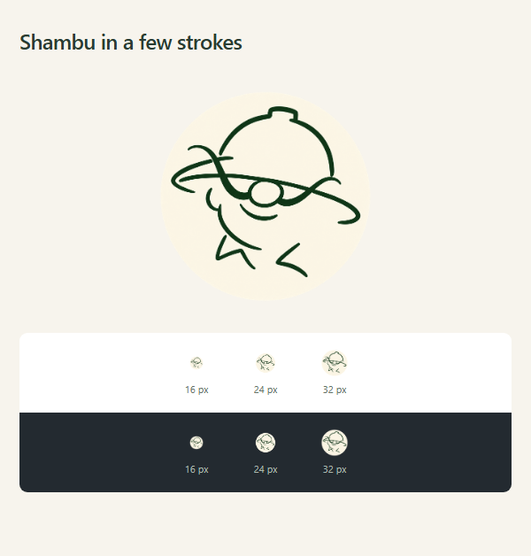
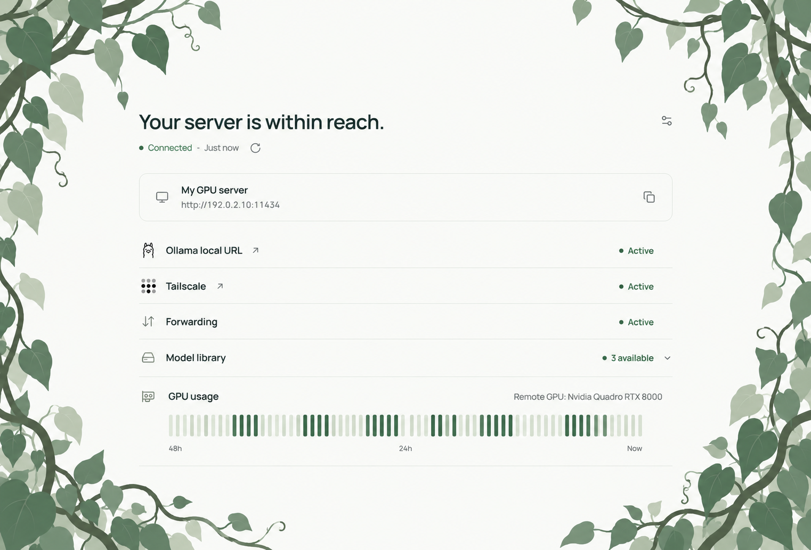
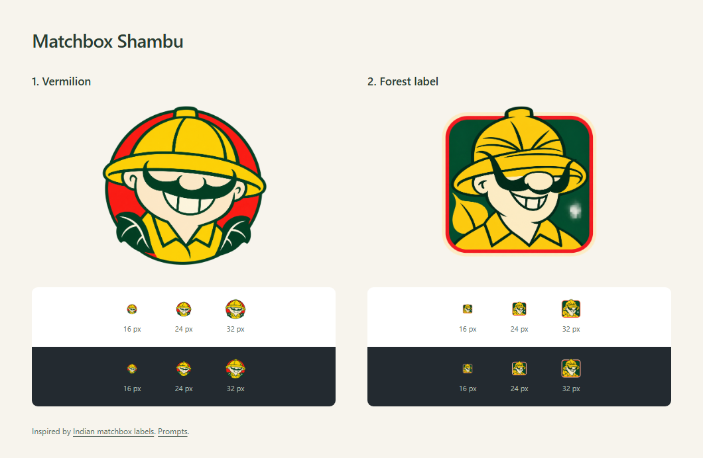
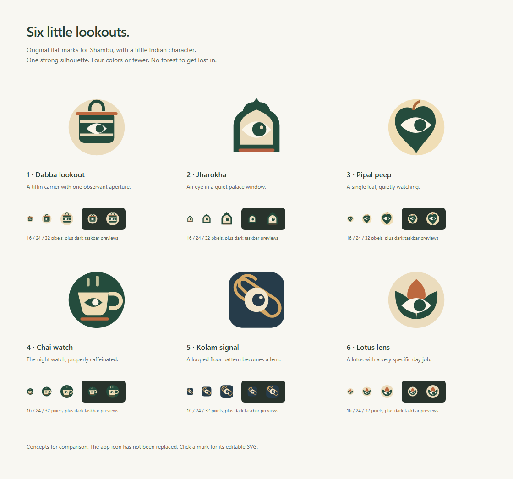
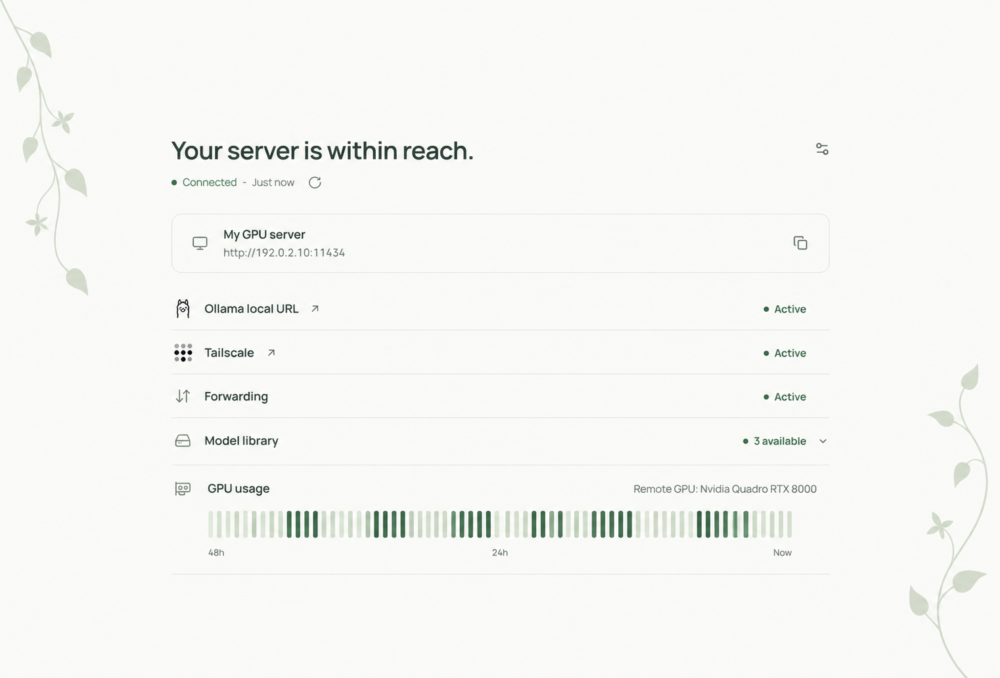
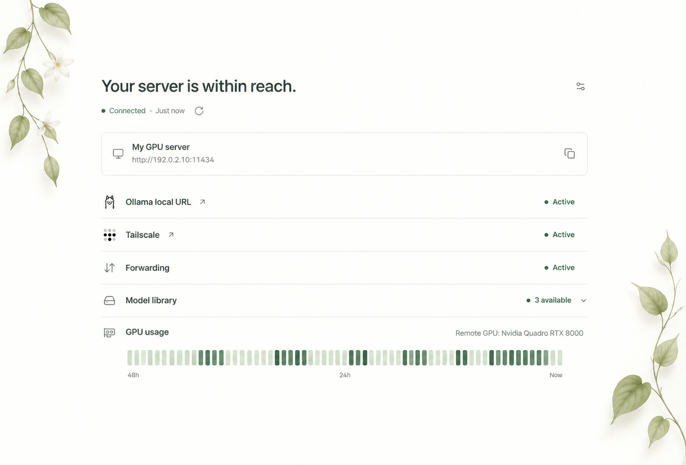

# Visual directions

## Shambu in a few strokes

A low hat, a round nose, the sweeping moustache and a grin. [Icon](shambu-stick-sketch.png) · [Size preview](shambu-sketch.html) · [Generation prompt](shambu-stick-sketch-prompt.txt).

## Overgrown creepers

Thick, tangled growth around a clear white center.

## Earlier matchbox portraits

1. [Vermilion](shambu-matchbox-vermilion.png): a round badge, broad hat and unmistakable grin.
2. [Forest label](shambu-matchbox-forest.png): a framed matchbox portrait in bottle green, mustard and cream.

[Open the size comparison](shambu-matchbox.html).

Color and composition references: [Indian matchbox labels at the Museum of Art & Photography](https://artsandculture.google.com/story/0AXRlx78fFkQqA) and [Rajesh Joshi's matchbox artwork](https://www.rajeshjoshi.com/match-box-art-by-rajesh-joshi/). Character references are in the [Shikari Shambu archive](../../app/assets/archive/shikari-shambu/README.md). [Generation prompts](matchbox-and-creepers-prompts.txt).

## Earlier icon options

Open [the comparison page](icon-options.html) locally to inspect the source artwork. Each icon is an editable SVG:

1. [Dabba lookout](01-dabba-eye.svg): a tiffin carrier with one observant aperture.
2. [Jharokha](02-jharokha.svg): an eye in a quiet palace window.
3. [Pipal peep](03-pipal.svg): a single leaf, quietly watching.
4. [Chai watch](04-chai.svg): the night watch, properly caffeinated.
5. [Kolam signal](05-kolam.svg): a looped floor pattern becomes a lens.
6. [Lotus lens](06-lotus.svg): a lotus with a very specific day job.

## Earlier vine studies

The center stays light and clear. Creepers live only along the outer margins.

**Flat:** sparse stems and graphic leaves.

**Softly shaded:** delicate botanical leaves with light texture and shadow.

[Asset provenance](ORIGIN.txt).
