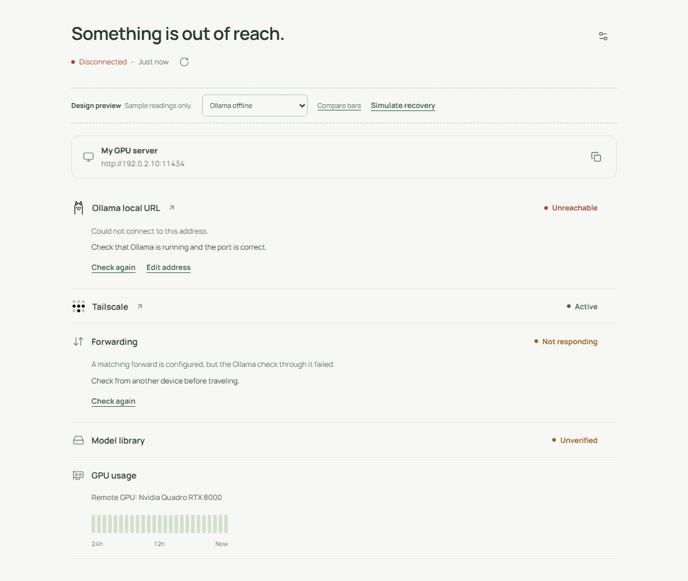
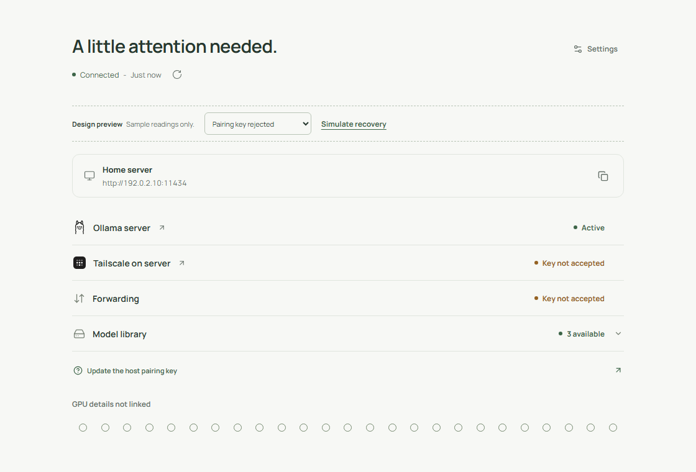
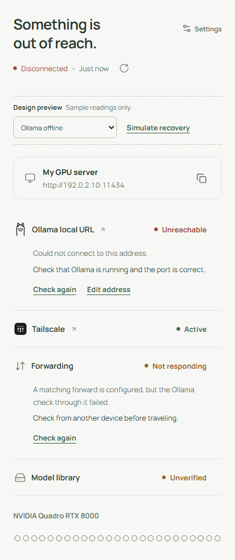

# Status and recovery previews

[Open the interactive state gallery](ux-states.html). The gallery uses captured, synthetic readings. It does not connect to or change a real server.

For a live development preview, run the app's Vite development server and open its local URL with ?demo=healthy. The preview selector covers all the states below. **Simulate recovery** changes the sample result to healthy and runs a preview check. These controls never appear in the installed app.

The page starts with readiness and an icon-only Settings action at the top right. The native title bar carries the app identity. Settings explains which server this device checks and ends with Cancel and Save on the right. Cancel discards edits; Save stores them and checks.

The combined summary uses green **Connected** only when current Ollama, Tailscale, forwarding, host evidence, GPU readiness, and model-library checks support it. GPU Idle is acceptable. Before the first result it reads **Checking** or **Not checked**. A fresh previous failure remains visible during refresh.

| State | What Shambu shows | Recovery |
| --- | --- | --- |
| Ready | Green Connected - Just now below the readiness heading, with verified connection and model checks. An idle GPU is healthy. | No action needed. Checks refresh every five minutes. |
| Ollama offline | Red Unreachable, Disconnected, and visible guidance. Dependent checks remain unverified. | Open Ollama on the GPU PC, or use Edit address if the URL is wrong. Check again after fixing it. |
| Tailscale disconnected | Amber Connection issue in the summary and Disconnected on the Tailscale row. Ollama may still be available locally. | Open Tailscale and connect or sign in. For a host-side failure, do this on the GPU PC. |
| Forwarding missing | Amber Connection issue in the summary and Not configured on the forwarding row. The server strip has no invented private URL. | Restore the matching private TCP forward on the GPU PC using the [setup guide](../README.md), then check again. |
| Pairing key rejected | Amber Check needed in the summary. The direct Ollama row can stay green while host checks say Key not accepted. | Choose Update the host pairing key, copy a current key from Shambu on the GPU PC, and save it in Settings on this device. |
| Host companion offline | Amber Check needed in the summary. Ollama can remain reachable while its host diagnostics are unverified. | Check the [host companion](host-agent.md), its private forward, and the host status URL in Settings. |
| CPU fallback | Amber Needs attention in the summary. The reachable server has a visible CPU detected warning about model allocation. | Check the GPU driver and Ollama's loaded-model allocation on the GPU PC. Restart Ollama only after its active work finishes. |
| No models | Amber Needs attention in the summary and an Empty model library with a download instruction. | Open Ollama on the GPU PC, download a model, then check again. |
| Stale readings | Muted old statuses, Check needed, the reading age, and the refresh icon. | Refresh once the app and connection are available. Stale data is never presented as a fresh all-clear. |
| Host not linked | Amber Check needed in the summary, with Not linked host checks. The Ollama row can remain Active. Unobserved GPU hours stay Idle. | Use Link host details and the optional pairing key to inspect the GPU PC's own checks. |

Launch links open the installed app on **this device**. See [native app links](native-launchers.md) for platform behavior. Opening another app does not mark a check healthy; only a new readiness result does that.

The last check reads **Just now** for less than two minutes, then **2 minutes ago**, **3 minutes ago**, and so on. Automatic checks run every five minutes while the app is visible and Settings is closed. A failed refresh or a reading at least five minutes and thirty seconds old marks existing evidence stale.

The **GPU usage** section shares the row icon and heading style. The GPU name appears on the right, above separate GPU load and VRAM readings. Its 49 Slender bars cover the rolling 48-hour window, including partial hours at either end, with **48h**, **24h**, and **Now** below. Active hours use a forest-green fill; Idle hours use a pale fill. Hover, tap, or use arrow keys for a tooltip such as **9 AM · Idle**, in the device local time zone.

## Ollama offline

## Pairing needs attention

## Phone

All screenshots use example addresses and synthetic model readings. Regenerate them with app/scripts/render-state-previews.mjs while the local Vite server is running.
